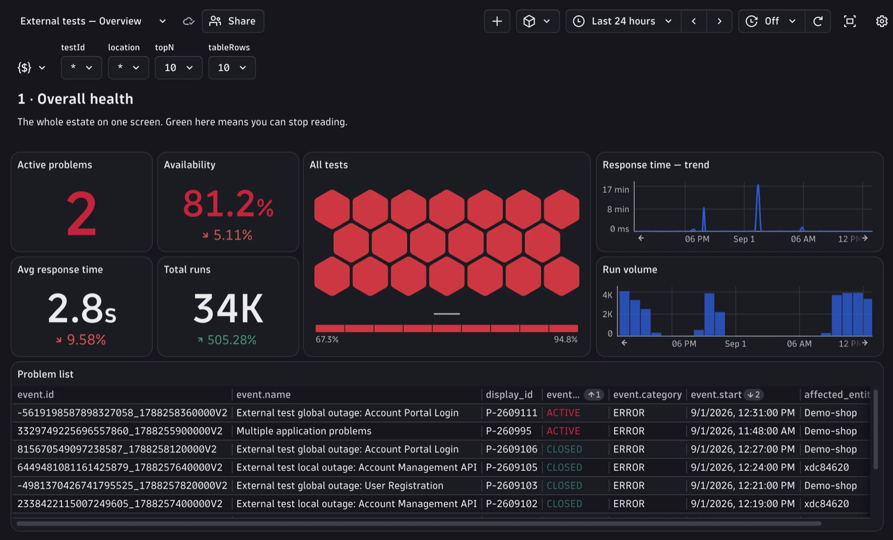
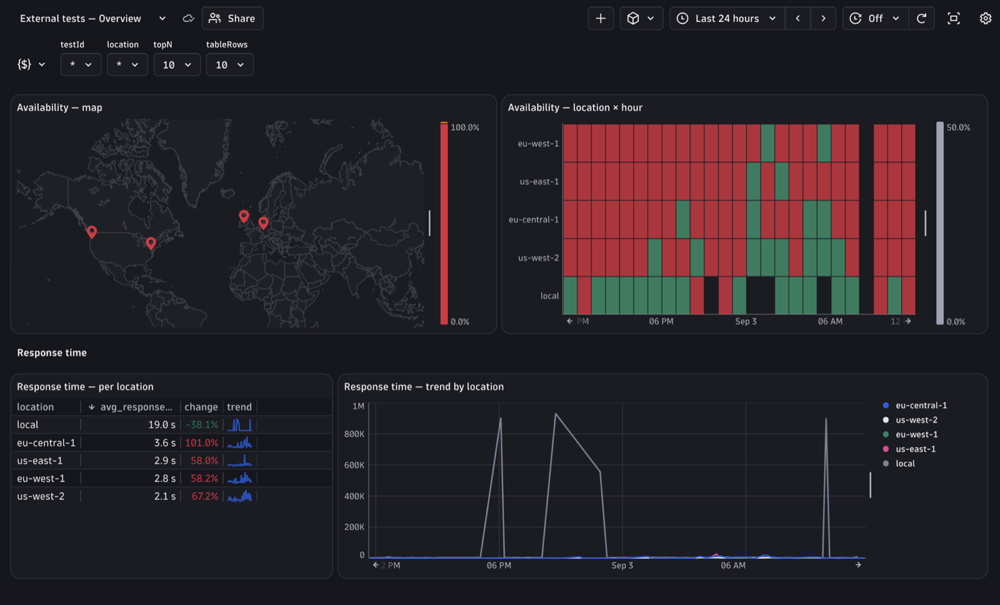
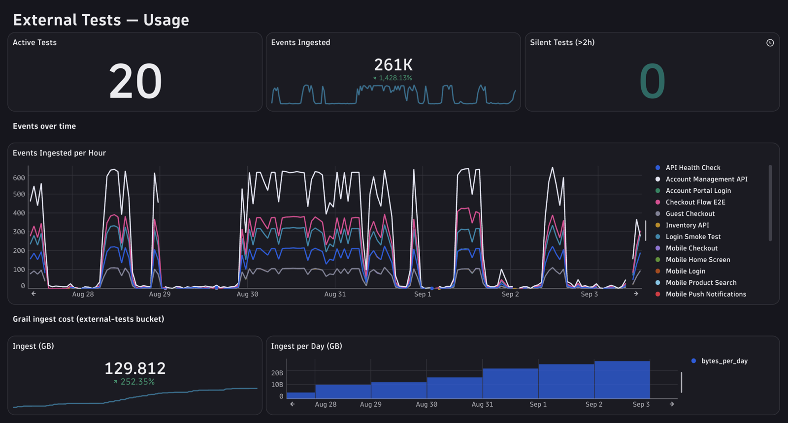

# Get started with external tests

- Latest Dynatrace
- Tutorial
- 25-min read

**External tests** are synthetic checks you run with your own tooling and send the results to Dynatrace: Playwright and Selenium suites, mobile or desktop app tests, protocol checks, load tests, or a third-party synthetic product.

This page takes you from an empty environment to a working external test. For the complete field-by-field schema, all pipeline processors, and the full DQL library, see [External tests reference](reference.md).



## Why bring them into Dynatrace

Dynatrace Synthetic Monitoring covers HTTP, Browser and NAM monitors from Dynatrace locations. A lot of what you monitor sits outside that scope:

- An endpoint reachable only from inside your network
- A protocol such as gRPC or MQTT
- A native mobile or desktop app
- A load test
- A check that a third-party tool already runs for you

Those results stay in the tool that produced them: its own dashboard, a CI log, an HTML report. Each tool has its own alerting and its own definition of "down". You cannot query those results together with your Dynatrace data, put them on a dashboard beside the service they test, or attach them to the application they affect.

## What you gain

**Every tool consolidated.** Results from different frameworks and vendors land in one environment, under one query language and one set of dashboards. You no longer maintain a separate view per tool, and you can answer questions that span tools: is this a global outage or one flaky suite?

**Attached to your topology.** Each test becomes a Smartscape node, and you can link it to the frontend or application it exercises. A resulting problem can then identify the affected application instead of appearing without application context.

**Unified DQL querying.** Test results are stored in Grail alongside your logs, metrics, and events, so a single query can span them.

**Integrated dashboards and problem workflows.** Test results become metrics, so you can build tiles and variables the way you do for other data sources. The bundled anomaly detectors can raise native Davis problems that flow through your existing notification profiles.

**Reporting gaps remain visible.** Maintenance runs are excluded from availability rather than counted as failures. The Usage dashboard also lists tests with no run in the last two hours. This can reveal a runner that stopped reporting, but it is not a missing-data alert, and the fixed window may also include healthy daily or on-demand tests.

**An extensible event schema.** The starter pack defines a small required field set for routing, metric extraction, topology, and correlation. You can add framework-specific context—such as a failing selector, stack trace, screenshot URL, or commit—without changing the pipeline.

## How it works

```
your runner  ──POST──▶  Dynatrace  ──▶  metrics, topology, problems, dashboards
```

At the end of each run, your runner posts a small JSON payload: one event for the run and, optionally, one event per step. Your runner sends the request; the starter pack provides the downstream processing and configuration.

## What the starter pack gives you

- A **dedicated ingest endpoint** for test results
- **OpenPipeline pipelines** that extract availability, duration, and failure metrics, register each test in Smartscape, and mask credentials in URLs
- **Four Davis anomaly detectors** (local outage, global outage, performance anomaly, and error code spike) that raise native Davis problems and flow through your existing notification profiles
- **Two dashboards**: Overview, Usage

It's all Monaco configuration that you own and can change: thresholds, metric keys, dimensions, and tiles.

## Prerequisites

| You need | Detail |
| --- | --- |
| Monaco CLI | Version 2.28.7 or later. See [Monaco documentation](https://docs.dynatrace.com/docs/deliver/configuration-as-code/monaco). |
| Deployment token | A platform token for configuration. See [Token scopes](reference.md#token-scopes). |
| Ingest token | A platform token with the single scope `openpipeline:events.custom:ingest`. |
| Permissions | Membership in a group with the **Data Processing and Storage** policy. Without it, OpenPipeline deployment fails with `403`. |
| A way to run tests | CI, cron, or a Kubernetes job. Whatever you already use. |

---

## Step 1 Deploy the starter pack

Clone the bundle and set two environment variables:

```bash
git clone https://github.com/Dynatrace/dynatrace-external-tests
cd dynatrace-external-tests

export DT_TENANT_URL=https://<your-tenant>.apps.dynatrace.com
export PLATFORM_TOKEN=dt0s01.XXXXXXXX.XXXXXXXX
```

Validate first, then deploy:

```bash
make validate     # monaco deploy --dry-run, changes nothing
make deploy
```

Deployment takes about 30 seconds. To confirm it worked, open Dynatrace and search your dashboards for **External tests**. You should see two: Overview and Usage.

> **Tip**
> `make delete` removes everything the bundle created. Your test data in Grail remains, because data and configuration are stored separately.

---

## Step 2 Send your first result

The starter pack creates an ingest endpoint on your environment's **classic** domain:

```
https://<environment-id>.live.dynatrace.com/platform/ingest/custom/events/external.tests
```

> **Warning**
> This is not the platform domain (`<tenant>.apps.dynatrace.com`). Both domains address the same environment, but only the classic domain accepts ingest.

Set the endpoint and your ingest token, then post a result:

```bash
export DT_ENDPOINT=https://<environment-id>.live.dynatrace.com/platform/ingest/custom/events/external.tests
export DT_TOKEN=dt0s01.YYYYYYYY.YYYYYYYY

curl -X POST "$DT_ENDPOINT" \
  -H "Authorization: Api-Token $DT_TOKEN" \
  -H "Content-Type: application/json" \
  -d '{
    "event.kind": "EXTERNAL_TEST_EVENT",
    "event.type": "external_test_run",
    "test.id": "my-first-test",
    "test.name": "My First Test",
    "test.run.id": "'"$(uuidgen)"'",
    "test.run.status": "passed",
    "test.run.availability": 1,
    "test.run.duration_ms": 1500,
    "timestamp": "'"$(date -u +%Y-%m-%dT%H:%M:%SZ)"'"
  }'
```

A successful ingest returns **HTTP 202**. You now have a processed test result: a metric data point, a Smartscape node, and a row in the Overview dashboard.

The next section explains what that payload contains and what to add to it.

---

## Step 3 The data model

A test result is expressed as two kinds of events.

| Event type | Represents | Send |
| --- | --- | --- |
| `external_test_run` | One execution of the test: one schedule tick, or one CI trigger | Exactly one per run |
| `external_test_step` | One action inside that execution: a navigation, an API call, or an assertion | One per step, optional |

The run event carries the verdict: whether the test passed, how long it took, and whether the target was available. Step events carry the detail that tells you *where* a run broke.

Field names follow the `test.*` namespace. The model stays close to what a test framework already produces, so mapping your runner's output onto it is straightforward and you don't have to drop detail along the way.

### Required fields

The pipeline relies on the following fields for routing, metric extraction, topology, or correlation. If a field is missing, the event may still be stored, but the corresponding processing step will not produce its expected output. The table shows how each field is used.

**Run events**

| Field | What the pipeline does with it |
| --- | --- |
| `event.kind` | Classifies the record as an external test result. Always `EXTERNAL_TEST_EVENT`. It limits your queries, and any routing rules you add later, to your test data. |
| `event.type` | The routing matcher. Always `external_test_run`. Without it, no pipeline processes the event: it lands in Grail as unprocessed JSON, with no metrics, no node, and nothing to alert on. |
| `test.id` | The Smartscape node ID is built from this field, and it is the primary dimension on every extracted metric. No `test.id` means no topology node and no per-test metric series. |
| `test.name` | Supplies the Smartscape node name and the test name in Davis problem titles. |
| `test.run.id` | Correlates step events back to their run. |
| `test.run.status` | Read by two extraction matchers: the availability metric excludes runs with status `maintenance`, and the failure counter only counts runs with status `failed`. |
| `test.run.availability` | Source field of `external.test.availability`. Both outage detectors read that metric. |
| `test.run.duration_ms` | Source field of `external.test.duration`, which the performance anomaly detector baselines. |

**Step events**

| Field | What the pipeline does with it |
| --- | --- |
| `event.kind` | Always `EXTERNAL_TEST_EVENT` |
| `event.type` | The routing matcher. Always `external_test_step`. |
| `test.id` | Copied into `dt.smartscape.ext_test` to stitch the step to its parent test node. Send it on every step, denormalized from the run. |
| `test.run.id` | Joins the step to its run |
| `test.step.index` | Dimension on the step duration metric, and the ordering of steps within a run |
| `test.step.name` | Dimension on `external.test.step.duration` |
| `test.step.status` | Normalized into `result.status.category` (`SUCCESS` / `SKIPPED` / `FAIL`) |
| `test.step.duration_ms` | Source field of `external.test.step.duration` |

`timestamp` is deliberately absent from both tables. Omit it and the platform stamps the record at
ingest, which is right for a runner that reports as soon as a test finishes. Send the execution
start instead if your runner batches or retries, because every metric here is a time series over
that value. Either way, stay inside the window: an event is accepted up to 24 hours old, but an
extracted metric only up to 1 hour, and anything older is dropped rather than clamped — so a runner
over an hour late leaves events in Grail and a hole in the metrics, with no error raised.

Two of the required fields need extra explanation.

- **`test.id` identifies the test definition, not the execution.** Keep it stable. It is the identity of the test in Smartscape, the main dimension on every metric, and the variable every dashboard filters on. If you rename it, you create a new test, and the history of the old one is no longer connected to it. Use `test.run.id` to identify a single execution.
- **`test.run.status` and `test.run.availability` are separate on purpose.** Availability answers whether the target was reachable, and the outage detectors read it. Status answers what happened, and it can be `failed` even when the target was reachable — for example, when a business assertion evaluated false. Merging the two would lose the distinction between "the site is down" and "the site is up but wrong".

### Recommended fields

The required fields tell you *that* a test failed. The fields below answer the questions you ask next, and they are grouped by those questions.

**Why did it fail?**

| Field | Why |
| --- | --- |
| `test.run.error_code` | A short, stable classifier such as `TIMEOUT`, `ASSERTION_FAILED`, `LOCATOR_NOT_FOUND`, `NETWORK_ERROR`, `AUTH_FAILED`, `RATE_LIMITED`, or `UNEXPECTED_STATUS_CODE`. This is the most useful optional field in the model: it lets you group and trend failures by cause instead of reading them one at a time, and the error code spike detector alerts on it. It also catches what an availability alert misses — a test whose availability has not changed, but whose failures switched from intermittent timeouts to `AUTH_FAILED`. Keep the list of codes short, because every distinct value becomes a metric dimension value. Prefer `UNEXPECTED_STATUS_CODE` with the status in a separate field over separate `HTTP_500`, `HTTP_502`, and `HTTP_503` codes. |
| `test.run.error_message` | The free-text detail for whoever reads the problem: the assertion diff, the stack trace, or the selector that never appeared |
| `test.step.error_message`, `test.step.screenshot_url`, `test.run.artifact_url` | The evidence: stack trace, screenshot, HAR, or video. Attaching it to the event keeps the investigation inside Dynatrace. |

**Where did it fail?**

| Field | Why |
| --- | --- |
| Step events | Narrow a failure down to the action that broke. This is the difference between "checkout is broken" and "the payment confirmation selector times out after 8.7 s". |
| `test.run.location` | The only way to tell a service outage apart from a single broken runner region. Per-location alerting, the difference between the local and global outage detectors, and location comparison all depend on it. A single-location test can omit it, but sending it consistently prepares the model for additional runners. |
| `test.run.location.lat` / `.lon` | Static coordinates of the runner, for geographic visualization. They describe where the runner sits, not what it tests. |

**What changed?**

| Field | Why |
| --- | --- |
| `ci.commit.sha`, `ci.branch`, `ci.pipeline.id`, `ci.trigger` | Turns "which commit broke this test?" into a query instead of an investigation |
| `runner.name`, `runner.version` | Distinguishes a real regression from a runner upgrade that changed the measurement |

**What is this test, and who owns it?**

| Field | Why |
| --- | --- |
| `test.type` | `browser`, `http`, `api`, or `mobile`. Lets you compare like with like and segment a mixed estate. |
| `test.frequency_sec` | The scheduled interval. You need it to size alert windows — how long an outage must persist before it is real. Omit it for CI-gate runs that have no schedule. |
| `dt.security_context` | Per-team Grail access policies and cost attribution |
| `dt.smartscape.frontend`, `dt.entity.application` | Link the test to the application it exercises, so Davis knows what a failing test affects. See [Link a test to the frontend](#link-a-test-to-the-frontend-it-exercises). |

The event model is extensible, so fields beyond this list can also be stored and queried. Send context that helps investigation, such as DNS and TLS timings, device model, viewport, tenant, or feature flags. Additional fields do not require pipeline changes, but they increase event size and may affect ingest and retention usage.

### A complete payload

Run plus two steps, for a checkout test that failed on payment. Post them together as a JSON array, in one request at the end of the run.

```json
[
  {
    "event.kind": "EXTERNAL_TEST_EVENT",
    "event.type": "external_test_run",
    "test.id": "checkout-flow",
    "test.name": "Checkout Flow — Production",
    "test.type": "browser",
    "test.run.id": "a1b2c3d4-e5f6-7890-abcd-ef1234567890",
    "test.run.status": "failed",
    "test.run.availability": 0,
    "test.run.duration_ms": 12340,
    "test.run.location": "eu-west-1",
    "test.run.location.lat": 53.33,
    "test.run.location.lon": -6.25,
    "test.run.error_code": "ASSERTION_FAILED",
    "test.run.error_message": "Step 2: timeout waiting for selector #payment-confirmation",
    "test.frequency_sec": 300,
    "ci.commit.sha": "9f2c1ab",
    "ci.trigger": "schedule"
  },
  {
    "event.kind": "EXTERNAL_TEST_EVENT",
    "event.type": "external_test_step",
    "test.id": "checkout-flow",
    "test.run.id": "a1b2c3d4-e5f6-7890-abcd-ef1234567890",
    "test.step.index": 1,
    "test.step.name": "Navigate to homepage",
    "test.step.type": "navigation",
    "test.step.status": "passed",
    "test.step.duration_ms": 1520,
    "test.step.url": "https://shop.example.com/"
  },
  {
    "event.kind": "EXTERNAL_TEST_EVENT",
    "event.type": "external_test_step",
    "test.id": "checkout-flow",
    "test.run.id": "a1b2c3d4-e5f6-7890-abcd-ef1234567890",
    "test.step.index": 2,
    "test.step.name": "Complete payment",
    "test.step.type": "assertion",
    "test.step.status": "failed",
    "test.step.duration_ms": 8720,
    "test.step.error_code": "ASSERTION_FAILED",
    "test.step.error_message": "Timeout waiting for selector #payment-confirmation",
    "test.step.screenshot_url": "https://artifacts.internal/runs/a1b2c3d4/step2.png"
  }
]
```

Credentials in `test.step.url` query parameters are masked by the pipeline, but sanitize them at the source as well — masking is a safety net, not a control.

---

## Step 4 See your results

Wait a minute or two, then open **Dashboards** and search for **External tests — Overview**. This is your starting point. It needs no configuration, and it's where you confirm that results are arriving and read the health of your test estate.

> **Tip**
> Every tile is scoped to the dashboard's timeframe picker. If you have sent a single result from
> Step 2, widen the timeframe to comfortably contain it — on a short rolling window the tiles empty
> out as soon as that one point falls off the back, which reads as a broken dashboard rather than a
> quiet one. The dashboards only look the way the screenshots do once tests report continuously.

<table>
<tr>
<td width="50%"></td>
<td width="50%"></td>
</tr>
</table>

Read the dashboard from the top down. It has four numbered sections, each narrower in scope than
the one before it: **Overall health** for the estate as a whole, **Tests, steps and failures** for
the breakdown per test, per step, and by error code, **Locations** for the same metrics per runner
location, and **Individual runs** for the executions themselves.

The first section aggregates across everything the filters admit, so it shows a broad outage
plainly and a single broken test barely at all. Read a clean top section as a reason to keep
scanning downward, not as permission to stop.

The middle two sections have the same layout: current state on the left, history on the right.

Four filters sit at the top. **testId** and **location** scope the page, **topN** limits how many
series the charts draw, and **tableRows** limits how many rows the tables list. The tiles that
ignore the location filter signal it directly: the two problem tiles include '— all locations' in
their titles, because Davis problems are raised against a test rather than a location; the two step
tiles carry a note in the sub-header directly above them.

### Why the dashboard is built this way

**The matrix tells you whether to blame the app or the runner.** The location section pairs a
map with a grid of location (rows) against time (columns), colored red where availability drops.
Look at the shape it makes, not the individual numbers:

- **One row red, the rest fine** → that one location is degraded. The problem is the runner, its
  network, or its region — not the application.
- **A whole column red, across all locations at once** → everything failed at the same moment.
  The problem is shared: a deployment, an upstream dependency, or an outage on the application
  side.

That is the difference between restarting a runner and paging the application team, and a single
number cannot show it to you.

**Tables rank by change, not by absolute value.** The slowest test is usually the same test every
day: a long user journey takes as long as it takes, so it tops a duration ranking without telling
you anything new. The test worth opening is the one that has doubled since earlier in the window,
even if it is nowhere near the slowest overall. Ranking by change shows it to you; ranking by
duration hides it.

The change column compares the recent half of the selected window against the earlier half, so it
follows the timeframe picker rather than a fixed period. Availability tables have the same column
in percentage points, with the direction reversed — there, an increase is good.

Both dashboards are views over the data model from Step 3. Each tile is a DQL query against the fields and metrics you just sent, so a dashboard also serves as documentation of what your events contain, and you extend it the same way.

| Dashboard | Answers | Reads |
| --- | --- | --- |
| **Overview** | Is my test estate healthy right now? | `external.test.availability` and `external.test.duration` for the headline numbers and trends; `test.name` for per-test breakdowns; `test.run.location` for location comparison and the **Location** filter; `test.run.location.lat` / `.lon` for the geographic map; `test.type` and `test.run.error_code` on the recent-runs table; Davis problems for the active problem count |
| **Usage** | What usage are the tests generating, and which tests have stopped reporting? | `external.test.usage.events_ingested` and `BILLING_USAGE_EVENT` records for run-event volume and attributable retention usage; metric data points extracted by the pipeline; `test.name` and `test.type` for the inventory table; `max(timestamp)` per test to identify tests with no recent runs |



> **Note**
> **The step section is empty without step events.** Its tiles filter `event.type == "external_test_step"`. If you send only run events the rest of the dashboard still works; add steps when you need to localize a failure within a journey.
>
> **Some tiles filter on `isNotNull(...)`.** If the field is missing, the tile is empty rather than partly filled. This applies to the geographic map (`test.run.location.lat`) and the error-message column on the worst-runs table (`test.run.error_message`).

### What sits underneath

The dashboards read four layers, each queryable and usable on its own.

**Raw events.** Everything you sent, queryable in Notebooks:

```
fetch events, from: -15m
| filter event.type == "external_test_run"
| fields timestamp, test.id, test.name, test.run.status, test.run.duration_ms
| sort timestamp desc
```

Steps of a specific run, in order:

```
fetch events, from: -15m
| filter event.type == "external_test_step"
| filter test.run.id == "a1b2c3d4-e5f6-7890-abcd-ef1234567890"
| fields test.step.index, test.step.name, test.step.status,
         test.step.duration_ms, test.step.error_message
| sort test.step.index asc
```

**Metrics.** Extracted from your events automatically:

| Metric | From | Consumed by |
| --- | --- | --- |
| `external.test.availability` | run events | Outage detectors, availability tiles |
| `external.test.duration` | run events | Performance anomaly detector, duration trends |
| `external.test.failures.by_code` | failed runs with an error code | Error code spike detector |
| `external.test.step.duration` | step events | Per-step performance tracking |
| `external.test.usage.events_ingested` | run events | Run-event volume and usage tracking |

```
timeseries availability = avg(external.test.availability), by: { test.id }, from: -1h
```

Metrics provide aggregated signals for dashboards and alerting, while raw events retain detailed execution context. In the starter pack's default bucket configuration, raw events are retained for 35 days. Alerts run on the extracted metrics; detailed investigations use the events.

**Topology.** Each unique `test.id` becomes a Smartscape node of type `EXT_TEST`:

```
smartscapeNodes "EXT_TEST"
| fields id, name, test.type, test.run.location
```

This node gives a Davis problem a name, such as *External test Checkout Flow — Production is unavailable*, instead of a problem raised against the environment with nothing to identify it.

> **Note**
> Query Smartscape with `smartscapeNodes`, not with `fetch`. Smartscape nodes are not classic entities, so `fetch dt.entity.ext_test` fails.

**Problems.** Once the deployed detector conditions are met, Davis raises a problem for the test node. Your existing notification profiles can route that problem without requiring a separate notification mechanism for external tests.

The **Test** and **Location** dashboard filters are built from the distinct `test.id` and `test.run.location` values seen in the last 30 days, so they populate themselves as you add tests and runner locations.

---

## Step 5 Send results from your own test

Wrap your test so that each run builds the payload from Step 3 and posts it once, at the end of the run. Add a step event as each step completes, add the run event when you know the result, then send a single POST to the ingest endpoint.

The `samples/` directory contains `basic-example.sh` for a single result with the minimum fields, a Playwright wrapper to copy from, and `full-example.sh`, which reports a small test estate with the complete field set — several tests, several locations with coordinates, and occasional failures carrying an error code. Run it to see what the model gives you once runners report everything, rather than inferring it from a single result.

Four things to get right, whatever your framework:

- **Post from a `finally` block.** If a run fails and reports nothing, you cannot tell it apart from a runner that crashed.
- **Stop at the first failed step** and omit the remaining steps. Leaving them out is clearer than sending a series of `skipped` events.
- **Map exceptions to a small, fixed set of error codes.** This is what makes `test.run.error_code` useful. Raw exception messages leave you unable to analyze failures by cause, and the spike detector cannot work with them.
- **Treat location as runner configuration, not test configuration.** `test.run.location` and its coordinates are the same for every test on a given runner, so read them from the environment instead of hardcoding them per test.

> **Tip**
> To see the dashboards before your own runner is ready, run `samples/full-example.sh`. It reports several tests from several locations and fails one of them periodically, so availability, per-location comparison and failures-by-cause all have something to show. `samples/basic-example.sh` sends a single result, which is enough to confirm ingest but not enough to read a dashboard.

---

## Adapt the starter pack

The starter pack is configuration you own, not a fixed product feature. The two changes below cover most of what you need in the first week.

### Tune an outage alert

The local outage detector fires when one test stays unavailable in one location. Four parameters in `monaco/custom-alerts/outage-detection-time-based/config.yaml` control its behavior:

```yaml
parameters:
  threshold: "0.5"            # availability below this counts as a violation
  sliding_window: "10"        # look at the last 10 one-minute intervals
  violating_samples: "5"      # fire after 5 of them violate
  dealerting_samples: "5"     # close after 5 clean intervals
```

With these defaults, a test must fail for about five minutes before Dynatrace alerts you. To react faster, lower `violating_samples`. To tolerate more flapping, raise it.

The parameter that needs the most care is `threshold`, because the global detector averages availability across locations. Consider a test running from three locations:

| Failing locations | Average availability | Fires at `0.5` | Fires at `0.1` |
| --- | --- | --- | --- |
| 1 of 3 | 0.67 | No | No |
| 2 of 3 | 0.33 | Yes | No |
| 3 of 3 | 0.00 | Yes | Yes |

This is why there are two detectors. The local detector keeps location in its grouping, so it evaluates each location separately and catches a single bad region. The global detector drops location from the grouping and uses a threshold of `0.1`, so it fires only when nearly every location is down. Route the local detector to the team that owns the runner, and the global detector to your on-call rotation.

> **Warning**
> Match `sliding_window` to your test cadence. A test that runs every 15 minutes cannot produce five one-minute violating samples, so it never alerts with these defaults. Raise the interval and the window to match your cadence.

Redeploy after editing:

```bash
make deploy
```

To restrict a detector to specific tests, uncomment `test_ids` in the same file:

```yaml
  test_ids: '"checkout-flow","login-smoke"'
```

### Link a test to the frontend it exercises

By default, a test appears in Smartscape on its own. Once you link it to a frontend, Davis knows which application a failing test affects, and the dependency appears on the topology map.

The pipeline draws the edge for you. You only need to identify the frontend, by adding two fields to your run events.

1. Find the Smartscape frontend ID:

   ```
   smartscapeNodes "FRONTEND"
   | filter contains(name, "<your-app>")
   | fields id, name
   ```

2. Find the classic application ID, which is what Davis problems and notification integrations use:

   ```
   fetch dt.entity.application
   | filter contains(entity.name, "<your-app>")
   | fields id, entity.name
   ```

3. Add both to every run event:

   ```json
   {
     "dt.smartscape.frontend": "FRONTEND-5F280D9DD8EF6A55",
     "dt.entity.application": "APPLICATION-4EFE35D6B0136138"
   }
   ```

4. Verify the edge after the next run:

   ```
   smartscapeEdges "monitors"
   | filter target_type == "FRONTEND"
   | fields source_id, target_id, target_name = getNodeName(target_id)
   ```

> **Note**
> The two IDs are not interchangeable, and neither one can be derived from the other, because they belong to different entity systems. Send both. `dt.smartscape.frontend` draws the topology edge, and `dt.entity.application` is the entity that Davis attaches the resulting problem to.

---

## Where to go next

| Goal | See |
| --- | --- |
| Look up every run and step field, required and optional | [Event schema reference](reference.md#event-schema-reference) |
| Stop planned maintenance from counting as downtime | [Maintenance windows](reference.md#maintenance-windows) |
| See which tests have no recent runs | The **No runs in the last 2 hours** tile on the Usage dashboard |
| Analyze run-event volume and retention usage | [Cost and usage tracking](reference.md#cost-and-usage-tracking) |
| Change a metric, dimension, or pipeline processor | [OpenPipeline configuration](reference.md#openpipeline-configuration) |

---

## Troubleshooting

**`401` or `403` on ingest.** The runner token needs exactly one scope: `openpipeline:events.custom:ingest`. The names `events.ingest` and `openpipeline.events.custom` are not valid scopes. Also confirm that the header format is `Authorization: Api-Token <token>`.

**`404` on ingest.** You're posting to the platform domain. Use `<environment-id>.live.dynatrace.com` instead.

**`202` returned, but `fetch events` finds nothing.** Dynatrace uses the `timestamp` value you sent, so a runner with an incorrect clock writes records outside your query window. Widen the timeframe, and confirm that `event.type` is exactly `external_test_run`.

**Events arrive, but no metrics appear.** Either routing doesn't match, or an extraction matcher excludes your events. The availability metric skips runs with `test.run.status == "maintenance"`, and the failure counter requires both `test.run.status == "failed"` and a non-null `test.run.error_code`.

**Deployment fails with `403`.** The token needs `storage:bucket-definitions:read` and `storage:bucket-definitions:write`, and the deploying user must belong to a group with the **Data Processing and Storage** policy.

**Redeploy fails with `409` on a dashboard.** The dashboard is sitting in the document trash, so Monaco tries to create it instead of updating it. Either restore it or delete it permanently from the trash, then deploy again.

**An alert never fires.** Check three things, in this order: the metric has data, `violating_samples` is achievable at your test cadence, and the threshold suits your location count. See [Tune an outage alert](#tune-an-outage-alert).

**A problem title shows a literal `{dims:test.name}`.** The referenced dimension is missing from the detector query's `by: {}` clause.

For the full troubleshooting list, see [External tests reference](reference.md#troubleshooting).

---

## Related topics

- [External tests reference](reference.md)
- [Data flow in OpenPipeline](https://docs.dynatrace.com/docs/platform/openpipeline/concepts/data-flow)
- [Configuration as code with Monaco](https://docs.dynatrace.com/docs/deliver/configuration-as-code/monaco)
- [Dynatrace Query Language](https://docs.dynatrace.com/docs/platform/grail/dynatrace-query-language)
